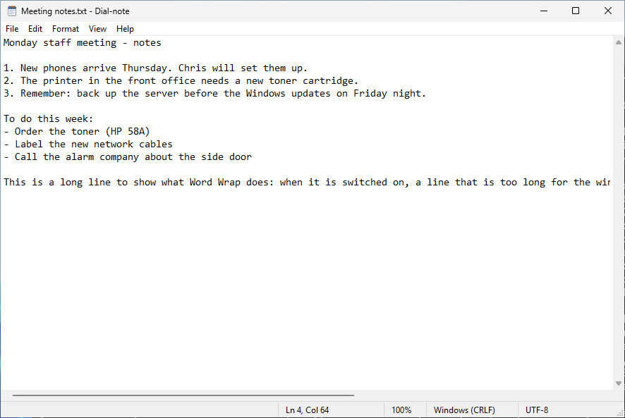
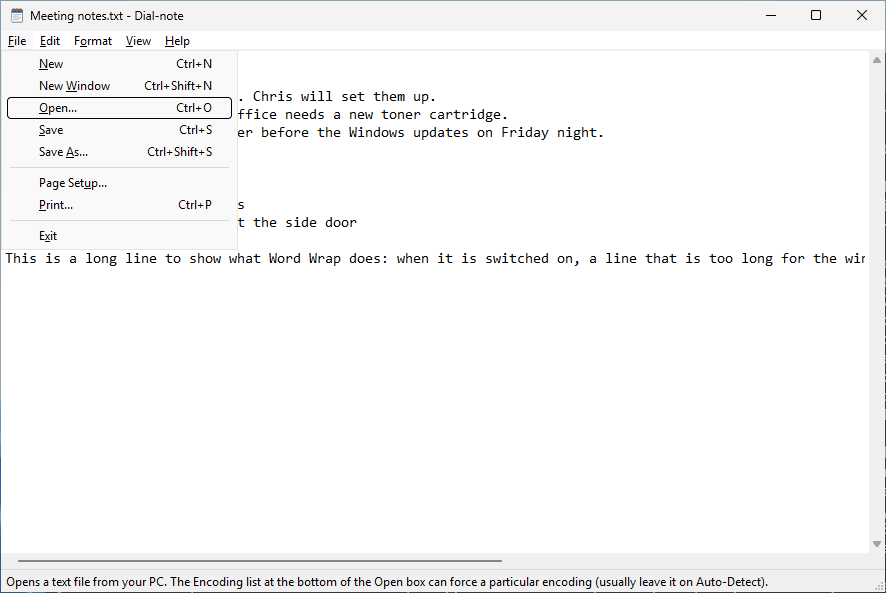
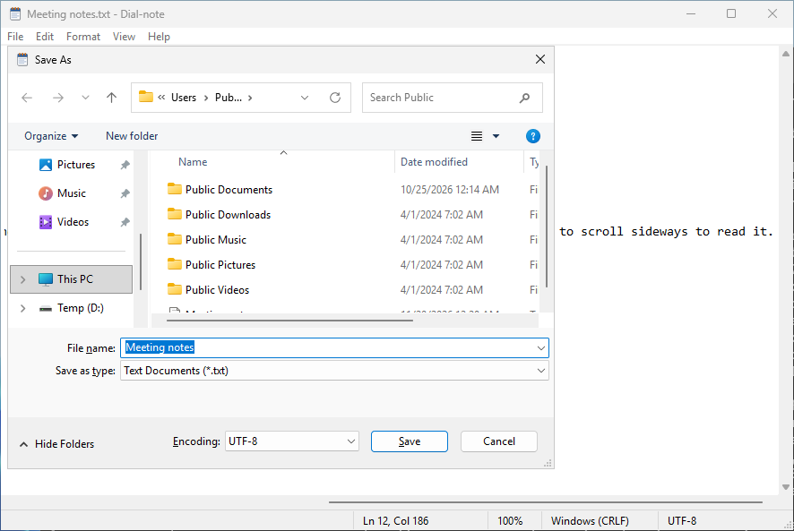
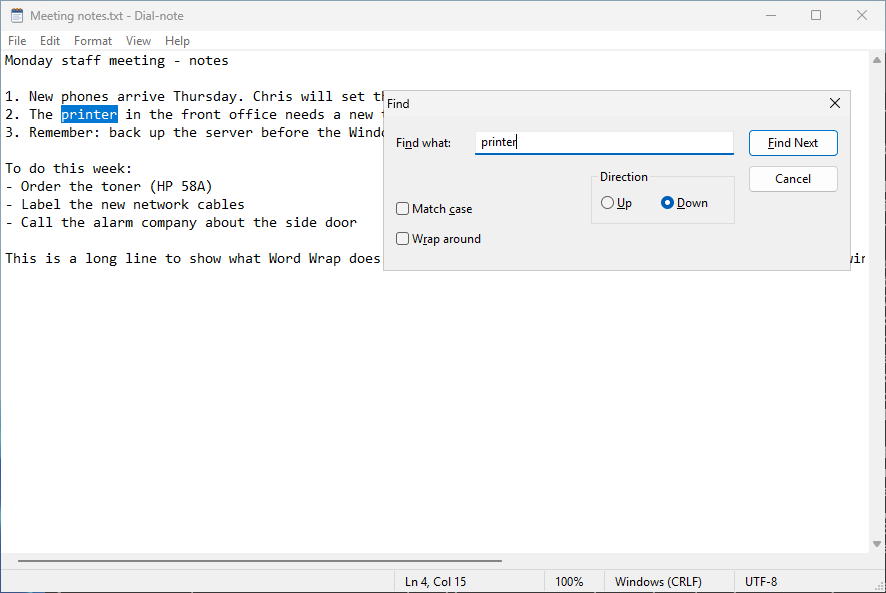

# Dial-note User Guide

Dial-note is a plain, simple text editor for Windows 10 and 11. It is a copy of the Notepad that came with Windows 10: the same menus, the same keyboard shortcuts and the same boxes, so there is nothing new to learn. It also keeps itself up to date, and everything in it explains itself: point at a menu item and the status bar at the bottom says what it does; rest the mouse on anything in a box and a tooltip explains it.

## Getting Dial-note

Download it from **dialsoft.com/dial-note**. It comes two ways; both are the same program.

- **Dial-note-Setup.exe**, the installer. It asks whether to install for **just you** (no administrator password needed) or for **everyone who uses the PC**. It adds Dial-note to the Start menu, optionally to the Desktop, and to the **Open with** list for text files, and lists it under Windows' *Installed apps* so it can be removed cleanly.
- **Dial-note.exe**, the portable copy. Nothing to install: save it anywhere (your Desktop, `C:\Tools`, a USB stick) and double-click it.

The first time, Windows may show a blue *"Windows protected your PC"* box. Click **More info**, then **Run anyway**.

### Making Dial-note open your .txt files

Windows 10 and 11 don't let a program make itself the default. To choose Dial-note: right-click any `.txt` file, choose **Open with › Choose another app**, pick **Dial-note** and tick **Always use this app to open .txt files**.

## The window

- **Title bar** – the file's name, followed by "Dial-note". A **\*** in front of the name (`*notes.txt - Dial-note`) means you have changes that aren't saved yet.
- **Text area** – where you type.
- **Status bar** (along the bottom; View › Status Bar) – from left to right:
  - a short message, such as "Replaced 3 times" after a Replace All;
  - **Ln, Col** – the line and column the cursor is on (a long line folded by Word Wrap still counts as one line);
  - the **zoom** (100% is normal size);
  - the file's **line endings**: *Windows (CRLF)*, *Unix (LF)* or *Macintosh (CR)*;
  - the file's **encoding**: *UTF-8*, *UTF-8 with BOM*, *UTF-16 LE*, *UTF-16 BE* or *ANSI*.

While a menu is open, the status bar shows what the highlighted menu item does.

## File menu

| Command | Shortcut | What it does |
|---|---|---|
| New | Ctrl+N | Starts an empty document in this window. |
| New Window | Ctrl+Shift+N | Opens a second Dial-note window. |
| Open… | Ctrl+O | Opens a text file. |
| Save | Ctrl+S | Saves to the same file (asks for a name the first time). |
| Save As… | Ctrl+Shift+S | Saves under a new name, in another folder or with another encoding. |
| Page Setup… | | Header, footer, paper size, orientation and margins for printing. |
| Print… | Ctrl+P | Prints the document, or just the selected text. |
| Exit | | Closes Dial-note. |

Whenever there are unsaved changes, Dial-note asks **"Do you want to save changes?"** with **Save**, **Don't Save** and **Cancel**, before it starts a new document, opens another file, closes, or Windows shuts down.

You can also **drag a file** from Explorer onto the Dial-note window to open it.

### Encodings

An encoding is the way letters are stored as bytes in the file. Dial-note handles the same five as Notepad:

| Encoding | When to use it |
|---|---|
| **UTF-8** | The modern standard and the default for new documents. Stores every language and emoji. |
| **UTF-8 with BOM** | UTF-8 with a 3-byte marker at the start. Some older Windows programs need it to recognize UTF-8. |
| **UTF-16 LE / BE** | Two bytes per character ("Unicode" in old Notepad). |
| **ANSI** | The old Windows code page. It can't store characters outside Western European languages; Dial-note warns you before saving if something would be lost. |

When opening, Dial-note works the encoding out by itself. If a file ever looks garbled, open it again and pick its encoding from the **Encoding** list at the bottom of the Open box. To change a file's encoding, use **Save As** and pick one from the **Encoding** list at the bottom of the Save box.

### Line endings

Windows ends each line with two invisible characters (CR LF); Linux and macOS use one (LF). Dial-note keeps whatever the file had, so a file from a Linux server is saved back the Linux way. The status bar shows which.

### Printing, header and footer

**Page Setup** sets what's printed at the top (header) and bottom (footer) of every page. The codes are Notepad's:

| Code | Prints |
|---|---|
| `&f` | the file name |
| `&p` | the page number |
| `&d` | today's date |
| `&t` | the time |
| `&l` `&c` `&r` | puts what follows on the left, in the center or on the right |
| `&&` | an ampersand (&) |

The standard header is `&f` (the file name, centered) and the footer `Page &p`. **Paper, margins…** opens Windows' own box for paper size, Portrait or Landscape, margins and printer. Long lines are folded to fit the paper, and the text is printed in your chosen font at its normal size (zoom doesn't affect printing).

## Edit menu

| Command | Shortcut | What it does |
|---|---|---|
| Undo | Ctrl+Z | Takes back your last change. Choose it again to redo. |
| Cut / Copy / Paste | Ctrl+X / Ctrl+C / Ctrl+V | The usual clipboard commands. |
| Delete | Del | Deletes the selected text. |
| Search with Bing… | Ctrl+E | Looks up the selected text on the web. |
| Find… | Ctrl+F | Opens the Find box. |
| Find Next / Find Previous | F3 / Shift+F3 | Repeats the last search, down or up. |
| Replace… | Ctrl+H | Opens the Replace box. |
| Go To… | Ctrl+G | Jumps to a line number. |
| Select All | Ctrl+A | Selects the whole document. |
| Time/Date | F5 | Types the current time and date. |

**Ctrl+Backspace** deletes the whole word to the left of the cursor.

### Find and Replace

The Find and Replace boxes stay open while you work in the document.

- **Match case** – capitals must match exactly ("Dial" won't find "dial").
- **Wrap around** – after reaching the end (or the start), carry on from the other end.
- **Up / Down** – which way Find Next searches.
- **Replace** replaces the highlighted match and moves to the next one; **Replace All** replaces every match at once. **Undo** (Ctrl+Z) takes back a whole Replace All in one step.

If you select a word before pressing Ctrl+F, it's filled in for you.

### The .LOG diary trick

Type `.LOG` (capital letters) as the very first line of a document and save it. From then on, every time you open that file, Dial-note adds the current time and date at the end and puts the cursor there – an easy diary or work log.

## Format menu

- **Word Wrap** – folds long lines onto the next row so they fit the window. The file itself isn't changed.
- **Font…** – the typeface, style and size. The standard font is Consolas, 11 point.

Both take effect immediately and are remembered for next time.

## View menu

- **Zoom** – **Zoom In** (Ctrl+Plus), **Zoom Out** (Ctrl+Minus), **Restore Default Zoom** (Ctrl+0). Holding **Ctrl** and turning the mouse wheel works too. Zoom goes from 10% to 500%.
- **Status Bar** – shows or hides the bar along the bottom.

## Help menu

- **View Help** (F1) – opens this guide.
- **Send Feedback** – opens the contact form on dialsoft.com.
- **Check for Updates…** – checks right now for a newer version.
- **Check for Updates Automatically** – when ticked, Dial-note checks quietly (at most twice a day). When a new version is out, **★ Update available!** appears at the right-hand end of the menu bar. Nothing is installed until you click **Update now**. Dial-note then downloads the new version, checks that it isn't damaged or tampered with (size, SHA-256 checksum and version), puts it in place, restarts and opens your document again.
- **What's New…** – the release notes.
- **About Dial-note** – the version number, and whether this copy is installed or portable.

## Starting Dial-note from a command line or shortcut

| Command | What it does |
|---|---|
| `Dial-note.exe` | An empty document. |
| `Dial-note.exe notes.txt` | Opens notes.txt. If it doesn't exist, Dial-note offers to create it. |
| `Dial-note.exe /p notes.txt` | Prints notes.txt on the default printer, then closes. |

## For IT: silent install

| Command | What it does |
|---|---|
| `Dial-note-Setup.exe /S` | Installs silently for the account running it. |
| `… /S /ALLUSERS` | Installs for everyone on the PC (run as administrator). |
| `/DESKTOP` | Also makes a Desktop shortcut. |
| `/NOOPENWITH` | Leaves the "Open with" list alone. |
| `/NOUPDATES` | Switches off automatic update checks (for PCs you update yourself). |
| `/D=C:\Folder` | Installs into that folder (must come last). |
| `"…\Dial-note\Uninstall.exe" /S` | Removes it silently. |

## Where things are kept

- **Settings** (window size and position, font, Word Wrap, Status Bar, Find choices, page setup) are in the registry under `HKEY_CURRENT_USER\Software\Dialsoft\Dial-note`, for your Windows account only.
- Dial-note sends nothing about you or your files anywhere. The only time it uses the internet is to check GitHub for updates (which you can switch off), and when you choose Search with Bing, View Help or Send Feedback.

---

© 2026 Dialsoft LLC · Marc Frega, Wharton NJ · Built with Claude by Anthropic.
